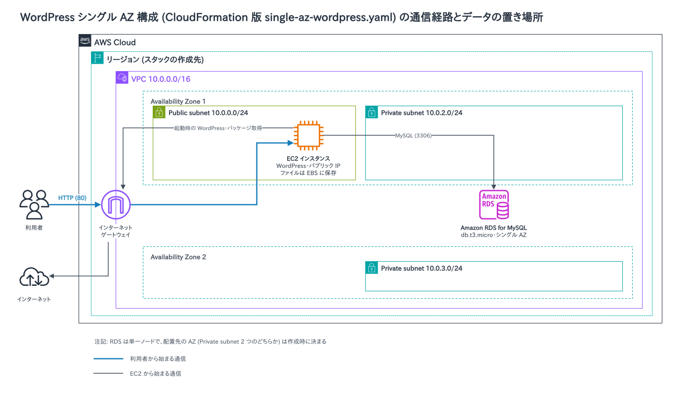
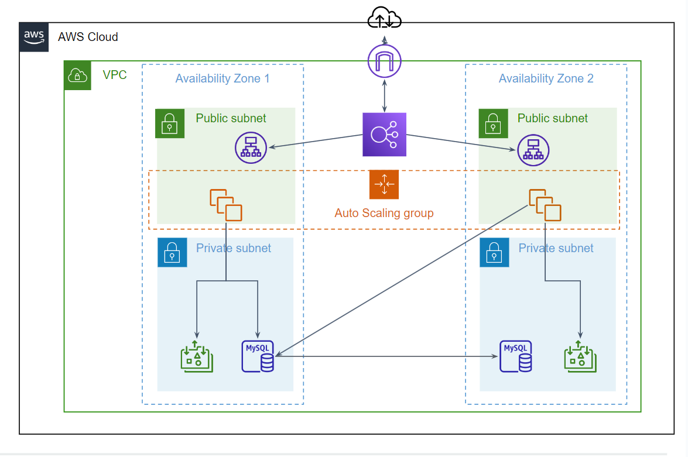

# scalable-website-cfn

WordPressを構築するCloudFormationテンプレートです。

- single-az-wordpress.yaml
  - 単一AZでのWordPress環境を作成します。
- multi-az-wordpress.yaml
  - マルチAZ配置で、Auto Scalingグループ（2台を維持）とRDSのマルチAZ配置により可用性を高めた環境を作成します。
- multi-template-stack/
  - ネットワークやデータベースなどを機能ごとのスタックに分割して作成する、多層アーキテクチャのテンプレートです。手順は [multi-template-stack/README.md](multi-template-stack/README.md) を参照してください。

各種詳細は以下で補足します。

## single-az-wordpress.yaml について

WordPressがインストールされた単一のEC2インスタンスを作成します。  
ネットワークについては2つのAZにサブネットを作成します。

アーキテクチャ図は以下の通りです。編集元は [single-az.drawio](single-az.drawio) です。

## multi-az-wordpress.yaml について

WordPressのファイル一式（`/var/www/html`）をEFSに置き、EC2をステートレスに保ちます。  
WordPressのサーバはAuto Scalingグループ（最小2・最大4・希望2）で2つのAZに配置します。  
スケーリングポリシーは設定していないため、負荷に応じた台数の増減は行いません。

アーキテクチャ図については以下の通りです。編集元は [multi-az.drawio](multi-az.drawio) です。

